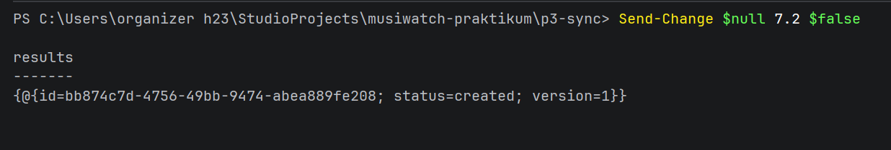
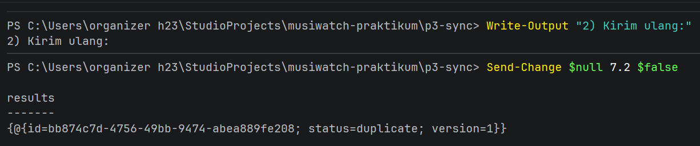
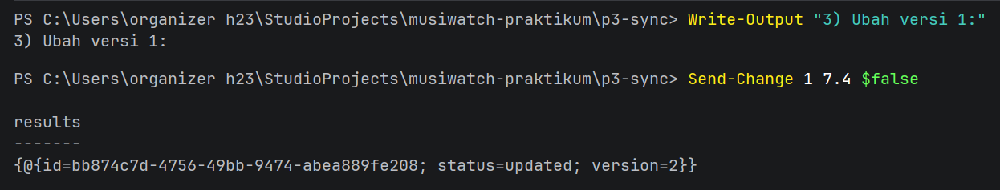
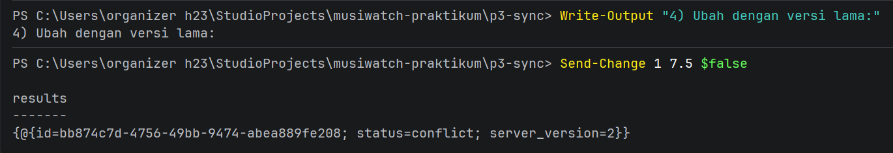
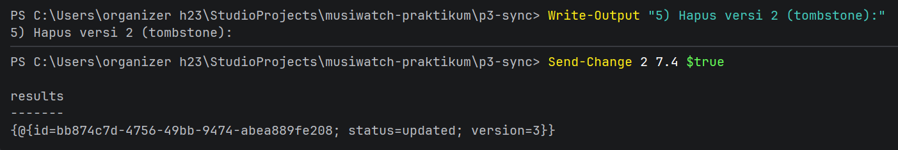
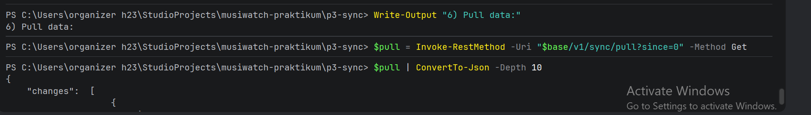
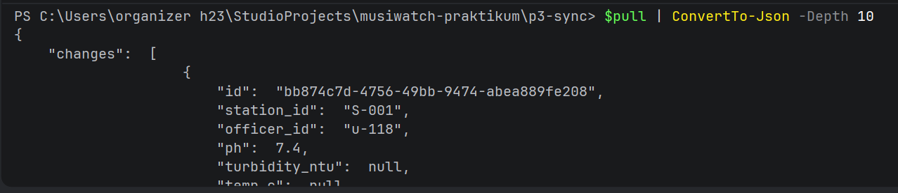
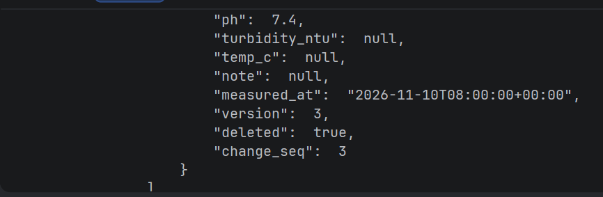
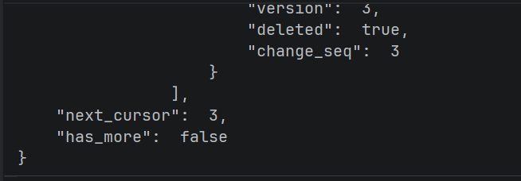

# Lembar Kerja Praktik 3 - Backend dan Sinkronisasi

Nama/NIM: Derry Arya Saputra, Muhammad Ikhsan Revaldi, Nadila Afisa Rani/ 09011282328036, 09011282328060, 09011182227003  

Tag Git: p3-final

## 1. (P3.1) Analisis kebutuhan data

MusiWatch merupakan aplikasi untuk mencatat hasil pengukuran kualitas air Sungai Musi oleh petugas lapangan. Karena pengukuran dapat dilakukan di lokasi dengan koneksi internet yang tidak selalu tersedia, aplikasi perlu menyimpan data terlebih dahulu pada perangkat. Data kemudian dikirim ke server ketika koneksi kembali tersedia.

### 1.1 Entitas dan karakteristik perubahan

| Entitas/data | Karakteristik | Alasan |
|---|---|---|
| Pengukuran kualitas air | Pada umumnya *append-only*; koreksi disimpan sebagai versi/perubahan baru | Setiap pengukuran mewakili kejadian pada waktu tertentu. Riwayat pengukuran perlu dipertahankan. |
| Catatan pengukuran | Dapat diperbarui oleh petugas yang berwenang | Catatan dapat dikoreksi jika terdapat kesalahan penulisan atau informasi tambahan. |
| Data stasiun | Relatif tetap dan dikelola oleh server/admin | Identitas dan lokasi stasiun menjadi acuan pengukuran dan tidak seharusnya diubah sembarang petugas. |
| Data petugas | Dikelola terpusat oleh server/admin | Identitas petugas perlu konsisten untuk mengetahui siapa yang melakukan pengukuran. |
| Status penghapusan pengukuran | Disimpan sebagai *tombstone* | Penghapusan perlu diketahui perangkat lain. Karena itu, baris tidak langsung dihapus secara fisik. |

### 1.2 Potensi konflik

Konflik dapat terjadi ketika satu pengukuran yang sama diubah dari dua perangkat sebelum keduanya melakukan sinkronisasi. Contohnya, perangkat A dan perangkat B sama-sama memiliki data pengukuran versi 1. Perangkat A mengubah nilai pH menjadi 7,4 dan berhasil mengirimkannya ke server sehingga versi server menjadi 2. Sementara itu, perangkat B masih mengubah data berdasarkan versi 1. Ketika perubahan dari perangkat B dikirim, server mendeteksi bahwa `base_version` yang dikirim tidak sama dengan versi terbaru di server. Server kemudian mengembalikan status `conflict`, bukan menimpa data versi 2.

Konflik juga dapat terjadi ketika satu perangkat mengubah catatan, sedangkan perangkat lain mengirimkan perubahan atau penghapusan pada data yang sama. Oleh karena itu, setiap perubahan perlu diperiksa berdasarkan versi data yang terakhir diketahui oleh perangkat.

### 1.3 Kebutuhan konsistensi dan mekanisme offline

MusiWatch menggunakan pendekatan **eventual consistency**. Data yang dibuat saat perangkat offline terlebih dahulu disimpan di database lokal Room dengan status `PENDING`. Setelah jaringan tersedia, aplikasi mengirim perubahan ke server melalui proses *push* dan mengambil perubahan terbaru melalui proses *pull*. Data lokal dan server dapat berbeda untuk sementara, tetapi diharapkan kembali konsisten setelah sinkronisasi berhasil.

Mekanisme yang digunakan untuk menjaga konsistensi adalah:

- Setiap pengukuran memiliki UUID yang dibuat oleh klien sebagai identitas unik.
- Perubahan menggunakan `base_version` untuk memeriksa apakah data yang diedit masih berdasarkan versi terbaru.
- Pengiriman ulang data baru dengan ID yang sama dikenali sebagai `duplicate`, sehingga tidak membuat baris baru.
- Penghapusan menggunakan *tombstone* (`deleted = true`), bukan menghapus baris secara fisik.
- Data lokal yang masih berstatus `PENDING` atau `CONFLICT` tidak boleh ditimpa oleh hasil *pull* dari server.
- Perangkat menyimpan cursor terakhir agar pengambilan perubahan berikutnya dapat dilanjutkan.

### 1.4 Risiko commit tidak berurutan dan mitigasi

`change_seq` diberikan ketika baris ditulis, tetapi transaksi database dapat melakukan *commit* dalam urutan yang berbeda. Sebagai contoh, transaksi A memperoleh `change_seq` 104 tetapi belum *commit*. Transaksi B memperoleh `change_seq` 105 dan lebih dahulu *commit*. Jika perangkat melakukan *pull* sampai cursor 105, perubahan 104 yang belum terlihat dapat terlewat ketika transaksi A baru *commit* setelahnya.

Pada implementasi praktikum, risiko tersebut dimitigasi menggunakan **PostgreSQL advisory transaction lock**, yaitu `pg_advisory_xact_lock(42)`. Lock tersebut membuat penulis diproses secara berurutan dalam transaksi sehingga urutan perubahan yang terlihat oleh proses *pull* lebih aman. Kekurangannya adalah konkurensi penulisan berkurang karena transaksi penulis harus menunggu giliran. Untuk sistem produksi, alternatifnya adalah menggunakan log replikasi database atau menahan cursor di bawah transaksi tertua yang masih berjalan.

## 2. (P3.2) Desain

### 2.1 Skema tabel server (PostgreSQL)

Server menggunakan tabel `measurements` untuk menyimpan data pengukuran dan riwayat versi perubahannya.

| Kolom | Tipe | Keterangan |
|---|---|---|
| `id` | UUID, primary key | ID unik yang dibuat oleh klien. |
| `station_id` | TEXT | ID stasiun pengambilan sampel. |
| `officer_id` | TEXT | ID petugas yang melakukan pengukuran. |
| `ph` | NUMERIC(4,2) | Nilai pH, dibatasi antara 0 sampai 14. |
| `turbidity_ntu` | NUMERIC(7,2) | Nilai kekeruhan dalam NTU dan tidak boleh negatif. |
| `temp_c` | NUMERIC(4,1) | Suhu dalam derajat Celsius. |
| `note` | TEXT | Catatan tambahan dari petugas. |
| `measured_at` | TIMESTAMPTZ | Waktu pengukuran. |
| `version` | INT | Versi data; nilai awal 1. |
| `deleted` | BOOLEAN | Penanda *tombstone*; `true` berarti data dihapus secara logis. |
| `change_seq` | BIGINT | Nomor urut perubahan yang diberikan server. |

Server juga menggunakan sequence `change_seq_gen` serta indeks pada `change_seq` dan kombinasi `station_id, measured_at` untuk mendukung pengambilan perubahan dan pencarian pengukuran berdasarkan stasiun serta waktu.

### 2.2 Skema tabel lokal (Room/Android)

Database lokal menjadi tempat penyimpanan pertama ketika petugas menyimpan pengukuran. Data yang belum berhasil dikirim ke server ditandai dengan status `PENDING`.

| Kolom | Tipe/isi | Keterangan |
|---|---|---|
| `id` | String UUID | ID yang dibuat oleh perangkat. |
| `stationId` | String | Identitas stasiun. |
| `officerId` | String | Identitas petugas. |
| `ph` | Double nullable | Nilai pH. |
| `turbidityNtu` | Double nullable | Nilai kekeruhan. |
| `tempC` | Double nullable | Suhu. |
| `note` | String nullable | Catatan pengukuran. |
| `measuredAt` | Long | Waktu pengukuran yang disimpan pada perangkat. |
| `version` | Int nullable | Versi dari server; `null` berarti belum pernah tersimpan di server. |
| `deleted` | Boolean | Penanda penghapusan/*tombstone*. |
| `syncState` | String | Status sinkronisasi: `PENDING`, `SYNCED`, atau `CONFLICT`. |

### 2.3 Kontrak API Push

**Endpoint:** `POST /v1/sync/push`

Klien mengirim kumpulan perubahan dalam properti `changes`. Setiap item berisi ID, versi dasar, identitas stasiun dan petugas, hasil pengukuran, waktu pengukuran, serta penanda penghapusan.

Contoh request:

```json
{
  "changes": [
    {
      "id": "UUID-dari-klien",
      "base_version": null,
      "station_id": "S-001",
      "officer_id": "u-118",
      "ph": 7.2,
      "turbidity_ntu": 12.5,
      "temp_c": 29.1,
      "note": "Pengukuran kondisi air",
      "measured_at": "2026-11-10T08:00:00Z",
      "deleted": false
    }
  ]
}
```

`base_version: null` digunakan untuk data baru. Untuk mengubah data yang sudah ada, klien mengirim versi dasar yang terakhir diketahui, misalnya `base_version: 1`.

Contoh response:

```json
{
  "results": [
    {
      "id": "UUID-dari-klien",
      "status": "created",
      "version": 1
    }
  ]
}
```

Status yang dikembalikan server untuk setiap item:

| Status | Arti | Tindakan klien |
|---|---|---|
| `created` | Data baru berhasil dibuat di server. | Tandai data lokal `SYNCED` dan simpan versi dari server. |
| `duplicate` | ID sudah ada dan kiriman merupakan pengulangan data baru. | Tandai `SYNCED` dan gunakan versi server yang dikembalikan. |
| `updated` | Perubahan berhasil diterapkan karena `base_version` cocok dengan versi server. | Tandai `SYNCED` dan perbarui versi lokal. |
| `conflict` | Versi dasar dari klien tidak sama dengan versi server. | Tandai `CONFLICT` dan pertahankan isi lokal agar tidak hilang. |

### 2.4 Kontrak API Pull

**Endpoint:** `GET /v1/sync/pull?since={cursor}&limit={jumlah}`

Klien mengirim cursor terakhir yang telah diproses melalui parameter `since`. Server mengembalikan perubahan dengan `change_seq` lebih besar dari cursor tersebut, diurutkan berdasarkan `change_seq`.

Contoh response:

```json
{
  "changes": [
    {
      "id": "UUID-dari-klien",
      "station_id": "S-001",
      "officer_id": "u-118",
      "ph": 7.4,
      "version": 2,
      "deleted": false,
      "change_seq": 125
    }
  ],
  "next_cursor": 125,
  "has_more": false
}
```

Klien menyimpan nilai `next_cursor` dan mengulang proses *pull* selama `has_more` bernilai `true`. Batas `limit` pada server dibatasi maksimal 500 data.

### 2.5 Aturan konflik dan sinkronisasi

1. Data baru dikirim dengan `base_version = null`. Jika ID belum ada, server menyimpan data dan mengembalikan `created`.
2. Jika ID sudah ada dan klien mengirim data baru lagi dengan `base_version = null`, server mengembalikan `duplicate`.
3. Jika data sudah ada dan `base_version` sama dengan versi server, perubahan diterapkan, versi dinaikkan satu, dan `change_seq` diperbarui.
4. Jika `base_version` tidak sama dengan versi server, server mengembalikan `conflict` tanpa menimpa data server.
5. Penghapusan dikirim sebagai `deleted = true` dan tetap disimpan sebagai *tombstone* agar perubahan penghapusan ikut tersebar ke perangkat lain.
6. Saat *pull*, aplikasi tidak menimpa data lokal yang masih berstatus `PENDING` atau `CONFLICT`.

### 2.6 Alasan menggunakan cursor `change_seq`, bukan timestamp perangkat

Cursor `change_seq` dipilih karena dibuat oleh server dan dapat diurutkan secara konsisten untuk proses *delta sync*. Jam pada perangkat pengguna dapat berbeda, tidak akurat, atau berubah karena pengaturan waktu dan zona waktu. Jika timestamp perangkat digunakan sebagai penanda sinkronisasi, perubahan dapat terlewat atau terbaca berulang akibat perbedaan jam. Dengan `change_seq`, klien cukup meminta perubahan yang memiliki nomor urut lebih besar dari cursor terakhir yang telah diproses.

## 3. (P3.3) Bukti implementasi

### 3.1 Implementasi backend dan pemeriksaan kesiapan

Backend dijalankan menggunakan Docker Compose. Pemeriksaan kesiapan layanan dilakukan melalui endpoint `/health/ready`. Pada pengujian yang dilakukan, endpoint memberikan respons:

```json
{"status":"ready"}
```

Respons tersebut menunjukkan bahwa API dan database dapat dijangkau pada saat pemeriksaan dilakukan.

### 3.2 Pengujian protokol Push dan Pull

Modul menyediakan skrip `scripts/test_sync.sh` untuk menguji lima perilaku push secara berurutan, kemudian mengambil data melalui pull. Skrip `test_sync.sh` menggunakan Bash, `curl`, dan `python3`, sehingga tidak dijalankan langsung dari PowerShell biasa. Pada pelaksanaan pengujian yang didokumentasikan di bawah, request dilakukan secara manual melalui PowerShell menggunakan `Invoke-RestMethod` dengan urutan dan skenario API yang sama. Untuk menjalankan skrip otomatis, gunakan Git Bash, WSL, atau Linux setelah API aktif, lalu jalankan `bash scripts/test_sync.sh` dari direktori `p3-sync`.

Hasil pengujian aktual:

| No. | Skenario | Hasil aktual |
|---|---|---|
| 1 | Mengirim data baru dengan `base_version = null` | `created`, versi 1. |
| 2 | Mengirim ulang data dengan ID yang sama dan `base_version = null` | `duplicate`, versi tetap 1. |
| 3 | Memperbarui data dengan `base_version = 1` | `updated`, versi 2. |
| 4 | Mengirim perubahan dengan `base_version = 1` ketika versi server sudah 2 | `conflict`, `server_version = 2`. |
| 5 | Mengirim penghapusan dengan `base_version = 2` dan `deleted = true` | `updated`, versi 3, `deleted = true`. |
| 6 | Mengambil perubahan melalui endpoint pull dengan `since = 0` | Data tombstone ditemukan dengan `change_seq = 3`; `next_cursor = 3` dan `has_more = false`. |

Pengujian menggunakan ID yang sama untuk seluruh urutan skenario, yaitu:

`bb874c7d-4756-49bb-9474-abea889fe208`

Data pengukuran yang diuji menggunakan `station_id` `S-001`, `officer_id` `u-118`, dan nilai pH akhir 7,4. Pada hasil pull, data memiliki versi 3 dan `deleted = true`. Hal ini menunjukkan bahwa data yang dihapus secara logis tetap dapat diterima melalui mekanisme pull.

**Status otomasi pengujian:** skrip `scripts/test_sync.sh` tersedia di repositori dan mencakup enam skenario di atas. Namun, hasil pengujian manual yang dijelaskan pada tabel merupakan bukti pelaksanaan yang dicatat dalam laporan. Jangan menyatakan skrip otomatis atau GitHub Actions berhasil dijalankan pada repositori ini sebelum terdapat log eksekusi yang berhasil.

**Bukti pengujian Push:**











**Bukti pengujian Pull:**









### 3.3 Implementasi klien Android dengan Room dan WorkManager

Aplikasi Android menggunakan Room untuk menyimpan pengukuran secara lokal. Setiap data memiliki status sinkronisasi `PENDING`, `SYNCED`, atau `CONFLICT`. `SyncWorker` menjalankan proses sinkronisasi di latar belakang.

Alur kerja `SyncWorker` adalah sebagai berikut:

1. Mengambil data lokal yang memiliki status `PENDING` melalui `dao.pending()`.
2. Jika terdapat data tertunda, mengirimkannya ke server melalui `api.push()`.
3. Memproses hasil push melalui `dao.applyPushResults()`.
4. Membaca cursor terakhir yang tersimpan pada `SharedPreferences`.
5. Mengambil perubahan server melalui `api.pull(cursor)`.
6. Menerapkan perubahan server melalui `dao.upsertFromServer()`.
7. Memperbarui cursor dan mengulang proses selama `page.hasMore` bernilai `true`.
8. Mengembalikan `Result.retry()` jika terjadi `IOException`, sehingga WorkManager dapat mencoba kembali.

Potongan kode utama dari `SyncWorker.kt`:

```kotlin
override suspend fun doWork(): Result = withContext(Dispatchers.IO) {
    try {
        val dao = AppDb.get(applicationContext).measurementDao()
        val pending = dao.pending()
        if (pending.isNotEmpty()) {
            val resp = api.push(PushBatch(pending.map { it.toChange() }))
            dao.applyPushResults(resp.results)
        }
        var cursor = prefs.getLong("cursor", 0L)
        do {
            val page = api.pull(cursor)
            dao.upsertFromServer(page.changes)
            cursor = page.nextCursor
            prefs.edit().putLong("cursor", cursor).apply()
        } while (page.hasMore)
        Result.success()
    } catch (e: IOException) {
        Result.retry()
    }
}
```

### 3.4 Potongan kode `applyPushResults`

Fungsi `applyPushResults` memproses status hasil push dari server. Status `created`, `updated`, dan `duplicate` mengubah data lokal menjadi `SYNCED` serta menyimpan versi server. Status `conflict` mengubah status lokal menjadi `CONFLICT` dan mempertahankan versi lokal.

```kotlin
@Transaction
open suspend fun applyPushResults(results: List<PushResult>) {
    for (r in results) when (r.status) {
        "created", "updated", "duplicate" ->
            setSyncState(r.id, "SYNCED", r.version)
        "conflict" ->
            setSyncState(r.id, "CONFLICT", byId(r.id)?.version)
    }
}
```

**Bukti kode:** potongan kode di atas merujuk pada implementasi `MeasurementDao.kt`. Lampirkan tangkapan layar kode dari Android Studio pada folder `docs/bukti/` apabila diminta sebagai bukti visual.

### 3.5 Potongan kode `upsertFromServer`

Fungsi `upsertFromServer` menerapkan perubahan yang diterima dari server. Sebelum melakukan *upsert*, fungsi memeriksa data lokal. Jika data lokal masih memiliki status selain `SYNCED`, perubahan dari server dilewati. Aturan ini mencegah data lokal yang masih `PENDING` atau `CONFLICT` tertimpa oleh data server.

```kotlin
@Transaction
open suspend fun upsertFromServer(changes: List<ServerChange>) {
    for (c in changes) {
        val local = byId(c.id)
        if (local != null && local.syncState != "SYNCED") continue
        upsert(c.toEntity())
    }
}
```

**Bukti kode:** potongan kode di atas merujuk pada implementasi `MeasurementDao.kt`. Lampirkan tangkapan layar kode dari Android Studio pada folder `docs/bukti/` apabila diminta sebagai bukti visual.

### 3.6 Checkpoint mode pesawat (offline-first)

Checkpoint pada modul dilakukan dengan urutan berikut:

1. Jalankan API dan database MusiWatch.
2. Aktifkan mode pesawat pada emulator atau perangkat Android.
3. Simpan lima pengukuran. Data harus tetap tersimpan pada database lokal dengan status `PENDING`.
4. Tutup aplikasi.
5. Matikan mode pesawat dan pastikan jaringan tersedia.
6. Tunggu pekerja sinkronisasi WorkManager berjalan.
7. Periksa bahwa kelima data sudah diterima server, muncul pada hasil pull tanpa duplikat, dan ikon status pada aplikasi berubah menjadi tersinkron (`SYNCED`).

Bagian ini merupakan checkpoint pengujian perangkat yang perlu dilengkapi dengan bukti layar atau log aktual dari emulator/perangkat. Bukti yang diperlukan adalah tampilan lima data ketika offline, proses setelah koneksi diaktifkan kembali, serta status data setelah sinkronisasi. Hasil checkpoint ini tidak disamakan dengan pengujian endpoint Push/Pull pada PowerShell karena keduanya menguji bagian sistem yang berbeda.

## 4. Refleksi

Item berstatus `CONFLICT` sebaiknya ditampilkan dengan penanda yang jelas, misalnya ikon peringatan dan label **“Perlu penyelesaian”**. Aplikasi perlu memberi tahu petugas bahwa data pada perangkat berbeda dengan data terbaru di server, tetapi tidak langsung menghapus atau mengganti data lokal.

Saat item dibuka, aplikasi sebaiknya menampilkan perbandingan nilai lokal dan nilai server, termasuk nilai pH, turbiditas, suhu, catatan, waktu perubahan, serta versi data. Petugas kemudian dapat memilih data yang benar atau menggabungkan informasi jika memungkinkan. Sebelum keputusan disimpan, aplikasi sebaiknya meminta konfirmasi. Setelah konflik diselesaikan, perubahan dikirim kembali ke server dengan versi dasar terbaru. Dengan cara ini, petugas memahami masalah yang terjadi dan data pengukuran tetap terjaga.

## Sumber dan bantuan (termasuk AI generatif)

1. Modul Praktikum FSK4110 Komputasi Bergerak dan Awan – Revisi 2, Praktik 3, halaman 11–15.
2. Paket kode `musiwatch-praktikum`, folder `p3-sync`, meliputi skema database, endpoint sinkronisasi, skrip pengujian, serta kode Android Room dan WorkManager.
3. Bantuan AI generatif (ChatGPT) digunakan untuk membantu menyusun uraian analisis, merapikan penjelasan desain, dan menjelaskan alur kode berdasarkan modul serta implementasi proyek. Kebenaran isi laporan dan kesesuaian bukti tetap perlu diperiksa oleh anggota kelompok.
